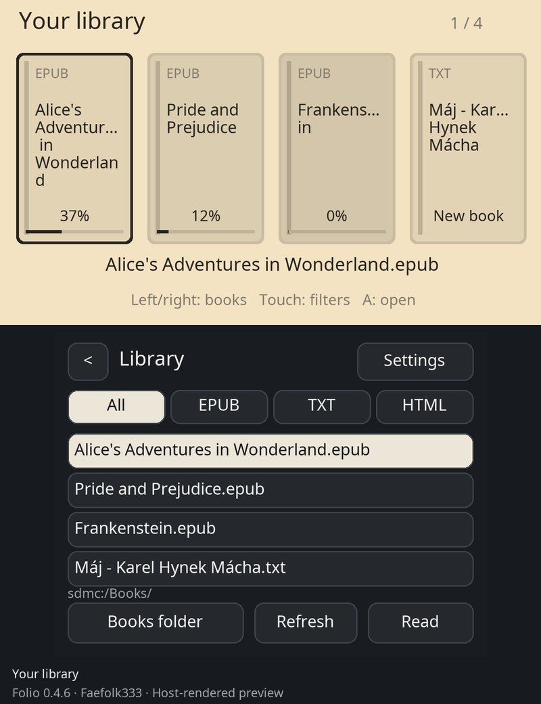

# Folio

By **Faefolk333** · [Stable releases](https://github.com/Faefolk333/Folio/releases/latest)
· [CIA test build 0.4.6](https://github.com/Faefolk333/Folio/releases/tag/v0.4.6)

**CIA startup notice:** 0.4.4 and 0.4.5 have user reports of "SD card was removed"
before Folio starts. The priority correction in 0.4.5 did not resolve that report.
Test build 0.4.6 adds the missing HOME launch logo to ExeFS and retains priority
48. This is an isolated packaging test, awaiting hardware confirmation.
Do not format the card or remove saved reading data for this issue.

A quiet, customizable e-reader for **New Nintendo 3DS**.

Read TXT, HTML and DRM-free EPUB books from your SD card. Folio puts the book on
the top screen and a minimal touch interface on the bottom.

- Five themes: Light, Warm, Paper, Dark and Red Night.
- Six font choices with adjustable text size, line spacing and letter spacing.
- Optional Bionic Reading emphasis and Focus Line.
- Recent-first library, saved reading positions and a removable per-book bookmark.
- Chapter/page jumps, L/R and ZL/ZR page turns, and line scrolling.
- English by default, with a selectable Czech interface.

## Install

Download `Folio-0.4.6-SD.zip` from the release and extract it to your SD card root.
Launch `/3ds/folio/folio.3dsx` from Homebrew Launcher. The archive also supplies
`/Folio/progress/`, which must exist for reading positions to save.

On a CFW-enabled New Nintendo 3DS, you can instead install `cias/folio.cia` from
that archive with your CIA installer (for example FBI). It creates a HOME-menu
entry. Extract the full SD ZIP first: installing the bare CIA does not create
`/Folio/progress/` or copy the bundled font notices. The CIA build is structurally
checked but has not yet been installed or launched on a real console.

In Library, choose **Books folder**, browse to your books and select **Use this
folder**. Exit with **START** after settings have finished saving.
When updating, preserve your own `/Folio/preferences*.cfg` and `/Folio/progress/`
files. Read the [English guide](Folio-Guide-EN.txt) or [český návod](Folio-Navod-CS.txt).

## Interface previews

These are **host-rendered previews**, not console or emulator screenshots.
They execute the native UI drawing code with approximate host font rasterization.



More views: [reading](sharing/previews/02-reading-paper.png),
[themes](sharing/previews/03-display-themes.png), [type](sharing/previews/04-type.png),
[settings](sharing/previews/05-settings.png), [Bionic and Focus](sharing/previews/06-bionic-focus.png),
[Red Night](sharing/previews/07-red-night-jump.png), and [Czech](sharing/previews/08-czech.png).

## Status and development

This project was developed substantially with **AI assistance (OpenAI Codex)**,
including source code and documentation. The previews are rendered from code;
no AI-generated bitmap artwork is bundled. The icon was supplied by the project
owner; bundled fonts retain their individual SIL OFL notices.

Version 0.4.6 has native 3DSX and CIA builds. CIA installation/launch is not yet
hardware-tested; see the release notes. Earlier 0.4.3 host regression checks cover
the unchanged reading and library logic.
Real-console verification of its latest controls and persistent library ordering
is still needed. The original hardware reports and subsequent fixes informed
development; this is an early homebrew release.

EPUB support is text-focused: no DRM, embedded artwork or complex CSS. PDF is
not implemented. The library is nonrecursive and limited to 256 entries.
Language, folder and saved positions persist; typography is session-only.
Startup opens Library; reopening a book restores its saved position. SD loading
remains synchronous and a stalled SD operation can still block input.

Current test build: 0.4.6. See CHANGES-0.4.6.txt for the CIA launch-logo test.
See CHANGES-0.4.3.txt for recent-first library ordering,
reading controls and publication previews. See sharing/ for English listing text.
Folder/language settings still use the asynchronous backend from 0.4.1.

Folio is a New Nintendo 3DS homebrew e-reader. It renders the reading page on the
top screen and keeps all interaction on the touch screen.

## Build

Install `devkitARM`, `libctru`, `citro2d`, `citro3d` and `3ds-zlib` through devkitPro, open a
devkitPro/MSYS shell in this directory and run:

```sh
make
```

With makerom and bannertool on PATH, run `make cia` for `folio.cia`.
See [CIA build notes](assets/cia/README.md) for pinned versions and identity.

The result is `folio.3dsx`. Copy it to `sdmc:/3ds/folio/folio.3dsx` (or any
Homebrew Launcher-visible directory).

## SD-card layout

Folio **only writes** below `sdmc:/Folio/`:

```
sdmc:/Folio/
  progress/<hash>.state    exact UTF-8 byte positions, bookmarks, text length
  preferences0.cfg        language/folder (checksummed alternating records)
  preferences1.cfg
```

Books remain where the reader found them. Open the library and browse from the SD
root. TXT, simple HTML/HTM and unencrypted EPUB 2/3 are readable.
EPUB is displayed as text, in the book's spine order. See EPUB.md and
BUILD-NOTES.md for limits. PDF is not supported.

STARTFIX 4: extract the entire SD ZIP to provide the Folio/progress folder.
The app does not create it at runtime. Choose Library > Books folder > Use this folder.
It refreshes after the first rendered frame on each launch. Hold Y at launch to skip
preferences/automatic scanning. No diagnostic SD log is written.

## Controls

In Library, left/right (D-pad or Circle Pad) selects books; up/down also works.
Format filters are touch-only. A opens, L/R moves four entries, X opens Settings
and Y chooses the books folder. Recently opened/resumed books sort first.

While reading:

* `L` / `ZL`: previous page; `R` / `ZR`: next page
* Circle Pad left/right: previous / next page; up/down: scroll the text one line
* Brightness: five software levels via touchscreen +/-
* D-pad up/down: scroll text on the main reader; navigate controls in submenus
* D-pad left/right: select controls; `A`: activate (first A selects the first control)
* `B`: back / close menu
* `X`: save/replace this book's bookmark, or remove it on its visible page; `START`: save and exit
* Touch / SELECT: wake the lower screen; the waking input is consumed
* L/R, Circle Pad, ZL/ZR: continue reading while the lower screen stays dark;
  these controls do not reset the lower-screen inactivity timer

## UI 0.4

Based on the actual original `reference/new3ds_ereader_mockup_v2.html`:

* Home tiles: Displej, Písmo, Nastavení; jump and bookmark; persistent library/brightness bar.
* Light, Warm, Paper, Dark and Red Night: original independent top/bottom palettes.
* Embedded Noto Sans, Noto Serif, Inter (default), EB Garamond, Folio Baskerville
  (derived from Libre Baskerville), and the 3DS system font; size 12–25, leading 1.15–2.05,
  letter spacing −0.04–0.12 em. All editable by touch with immediate reading-page reflow.
* Font coverage: embedded Latin/Latin Extended-A and general punctuation, including Czech;
  system font coverage depends on console region. This is not universal Unicode coverage.
* Focus Line: one row at full contrast, every other row at 27%; move via Settings.
* Bionic: first part of each word emboldened, with three strengths from the HTML rules.
* Chapter/page jump (tap page number for numeric keyboard); one replaceable bookmark per book.
* Saved, nonrecursive books folder; up to 256 entries with a truncation notice.
* Upper-screen typographic book cards with filenames and saved percentages, not EPUB cover images.
* English default with selectable Czech for menus and ordinary errors. Startup diagnostics remain English.
* Real lower-only backlight off requested on sleep; touch/SELECT wake and exit/suspend restore.
  Service refusal is reported, with black-image fallback. Hardware testing is still required.

Progress is an exact UTF-8 byte offset, retained when typography changes. A reflow may show
the beginning of the newly wrapped line containing that anchor. Save happens when opening
the library, switching books, setting a bookmark, or exiting with START; abrupt power-off
can lose progress since the last save. No SD operation is done before the first frame.
Language and books folder persist. Other reading preferences remain session-only.

Inter plus open Garamond/Baskerville variants extend the original Noto fonts.
The proprietary system families listed in the HTML are not bundled. Glyph rasterization and the SD browser
are native, not an embedded web browser. PDF, images and EPUB CSS are not implemented.

## Project structure

* `source/main.c` — UI loop, rendering, storage and SD browser
* `source/ui.c` — shared, testable control geometry and settings actions
* `source/reader.c` — UTF-8 word wrapping, byte anchors, Focus and Bionic rules
* `source/document.c` — document loading and HTML-to-text normalisation
* `source/epub.c` — bounded ZIP reader, OPF spine and XHTML text conversion
* `include/folio.h` — parser-facing document model; add EPUB/PDF parsers here

The supplied open-book icon is included unmodified as `assets/icon.png`; the
Makefile turns it into SMDH metadata for a branded Homebrew Launcher entry.

Noto font license and original editable TTF files are in `assets/fonts/` (SIL OFL).
See `BUILD-NOTES.md` for verification and installation notes. All font licenses are in `assets/fonts/`.

The parser supports UTF-8, UTF-16 with BOM (or an XML byte-order signature), declared
Windows-1250 / ISO-8859-2 / Windows-1252, named HTML entities, and composition of common
Latin diacritics. Undeclared non-UTF-8 input is assumed Windows-1250, which is a heuristic.
This is not full Unicode normalization. Already-corrupted replacement characters in an
input book cannot be reconstructed. Conversion may change byte offsets relative to old
versions, so previously saved positions in affected books may need adjustment.
